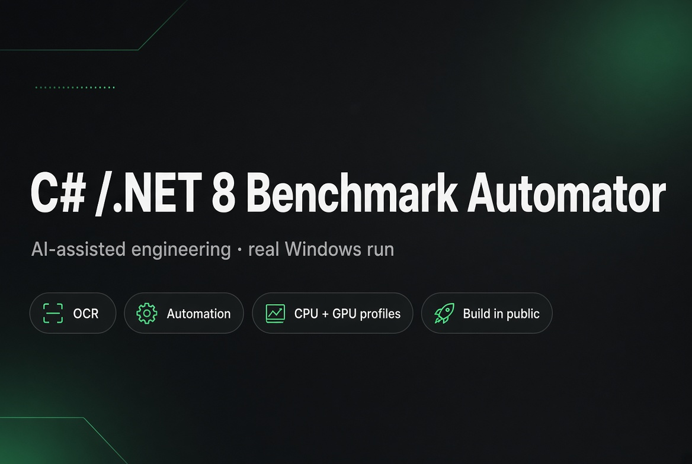

# Black Myth: Wukong Benchmark Automator

.NET 8 console tool that runs the free *Black Myth: Wukong Benchmark Tool* (Steam AppID **3132990**) twice with different graphics profiles and produces a readable report with real FPS numbers.



## What it does

1. Locates the Benchmark Tool (Steam registry / library folders / `WUKONG_BENCHMARK_PATH`).
2. Collects system info (CPU, GPU, RAM, OS).
3. **CPU-test** – low resolution + lowest quality → launch tool → you start the benchmark → enter the numbers from the results screen.
4. **GPU-test** – high resolution + maximum quality + RT → same flow.
5. Prints a full report to the console and saves a timestamped `.txt` file.

## Automatic results (OCR)

After each benchmark pass the tool:

1. Waits until you press **Enter** (results screen visible)
2. Takes a **fullscreen screenshot**
3. Crops the left column («Результаты теста»)
4. Runs **Tesseract OCR** + regex (RU/EN labels)
5. Fills Average / Max / Min / 5% Low
6. Optionally asks you to confirm or correct (press Enter to keep OCR value)

### Setup OCR once

```bash
mkdir tessdata
# download eng.traineddata into tessdata/
# https://github.com/tesseract-ocr/tessdata_fast/raw/main/eng.traineddata
```

### Arguments

| Argument | Meaning |
|----------|---------|
| `--width N` / `--height N` | GPU-test resolution |
| `--no-prompt` / `-q` | Do not ask to confirm OCR numbers |
| `--no-ocr` | Skip screenshot/OCR (manual only) |

### Debug

OCR writes a debug crop: `%TEMP%\wukong_ocr_debug_CPU.png` (and GPU).  
Open it if Average/Max/Min look wrong — adjust crop in `OcrResultsParser.CropLeftResultsColumn`.

## Project structure

```
WukongBenchmarkAutomator/
├── WukongBenchmarkAutomator.csproj
├── Program.cs
├── README.md
├── LICENSE
├── Models/
│   ├── SystemInfo.cs
│   └── BenchmarkResult.cs
└── Services/
    ├── SteamLocator.cs
    ├── IniSettingsManager.cs
    ├── SystemInfoCollector.cs
    ├── BenchmarkRunner.cs
    └── ResultsParser.cs
```

## License

MIT

## Disclaimer

Independent community tool. Not affiliated with Game Science or Steam.  
Benchmark results are indicative only.
